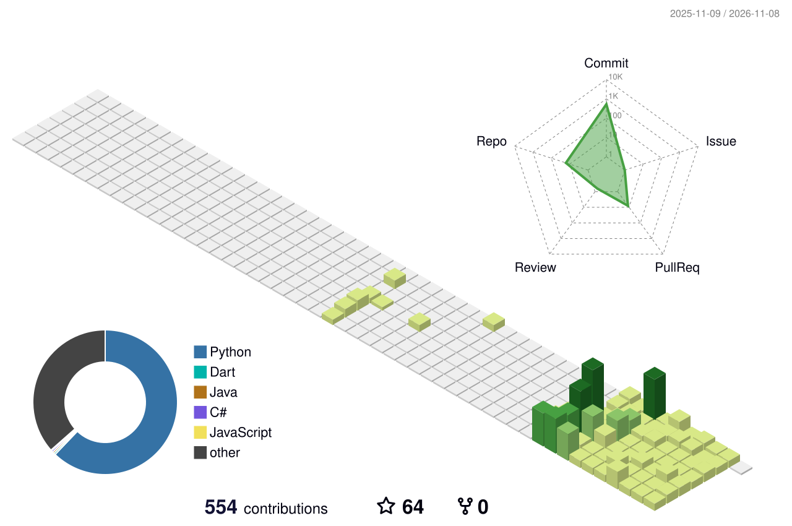

<picture>
<source media="(prefers-color-scheme: dark)" srcset="https://readme-typing-svg.demolab.com?font=Fira+Code&weight=600&size=23&duration=3000&pause=900&color=39FF14&center=true&vCenter=true&width=740&lines=Software+Engineer+%2B+Research+Master+%40+ENIT;Autonomous+Pentesting+with+LLM+Agents+%2B+LangGraph;RAG+Systems+%26+Computer+Vision+(YOLOv8);AI+%C3%97+Security+%C3%97+Communications">

</picture>

  

 

> [!TIP]
> **This README is the highlight reel.** For live project demos, case studies, certifications and full academic reports, visit my portfolio → **[wael-hammali.vercel.app](https://wael-hammali.vercel.app/)**

### 🔬 Research Focus

I'm moving from applied engineering toward **research**, around one question:

> **How can autonomous, multi-agent AI (LLM reasoning, RAG, computer vision) be applied to security and communication systems that operate reliably in the real world?**

- **Security** — the reasoning layer behind IntelForge / VoidHawk: LangGraph-orchestrated agents that plan, validate and rank findings with persistent (RAG) memory instead of single-shot prompting.
- **Communication & networked systems** — SYSCOM coursework in RF/antenna systems, wireless communications, IoT and signal processing, with AI/ML as the connecting layer.
- **Applied computer vision** — in **SympactAI (2nd Edition)** at TAIS NextGen, I led a jersey-number recognition module (Real-ESRGAN + ViTPose + PARSeq) for AR sports analytics.
- **Network-to-Cloud translation** — multimodal AI pipeline turning network diagrams into deployable Terraform & Ansible IaC, at **RISC Lab, ENIT**.

🌍 **Open to research internships and graduate research collaborations** (Mitacs-style programs included), especially at the intersection of AI/ML, autonomous agents, and security or communication systems.

`AI / ML for Security` · `Multi-Agent LLM Systems` · `RAG & Long-Term Memory` · `Computer Vision` · `Wireless & Communication Systems` · `IoT · Signal Processing`

---

### 📰 Publications

| Year | Title | Venue |
|------|-------|-------|
| **2026** | Multimodal AI Approach to Converting Network Diagrams into Cloud Infrastructure *(co-authored)* | **IEEE AIDIST 2026** (accepted) |

---

### 🧠 About Me

- 🎓 **B.Eng. in Software Engineering** @ **ENIT** (2024–2027) — AI, Computer Vision & Cybersecurity
- 🔬 **Research Master in Communication Systems (SYSCOM)** @ **ENIT** (2026–present) — AI/ML for communications, networks & signal processing
- 🛡️ **Offensive security** — autonomous, LLM-driven penetration-testing frameworks (OSINT → recon → exploit intelligence)
- 🤖 **Applied AI** — fine-tuned YOLOv8, RAG pipelines, multi-agent orchestration with **LangGraph**
- 🏴 CTF & **HackTheBox** player · member of **Securinets ENIT** · 📍 Tunis, Tunisia

---

### 🚀 Featured Projects

<table>
<tr>
<td width="50%" valign="top">

**[🛡️ IntelForge](https://github.com/WaelHammali/IntelForge)**

Autonomous pentest & recon framework: passive OSINT + Nmap TCP/UDP recon, condensed by a **LangGraph** pipeline of LLM agents (Cleaner → Analyst → Researcher → Synthesis) into a structured exploit-intelligence report.
`Python · LangGraph · Groq · DeepSeek R1`

</td>
<td width="50%" valign="top">

**[☁️ RAG Net-to-Cloud Automation](https://github.com/WaelHammali/Advanced-RAG-For-Net_To_Cloud-Translation)**

Reads network architecture diagrams with **YOLOv8** + **RAG** and auto-generates production-ready **Terraform & Ansible** IaC. Co-authored paper accepted at **IEEE AIDIST 2026**.
`Python · YOLOv8 · RAG · Terraform · Ansible`

</td>
</tr>
<tr>
<td width="50%" valign="top">

**[🕶️ VoidHawk](https://github.com/WaelHammali/VoidHawk)**

6-agent **LangGraph** state machine (Planner · Worker · Cleaner · Analyst · Logic · Validator) with **RAG memory** (ChromaDB), producing **CVSS-scored** reports in PDF / HTML / Markdown. Chained into **[DarkIntel](https://github.com/WaelHammali/DarkIntel)**.
`Python · LangGraph · Groq · ChromaDB`

</td>
<td width="50%" valign="top">

**[⚽ Jersey Number Recognition](https://github.com/WaelHammali/Jersey-number-pipeline-extension)**

**Real-ESRGAN** super-resolution + pose estimation to read jersey numbers in low-res, motion-blurred soccer footage. Improves SoccerNet tracklet accuracy from 89.63% → 94.07%. *(SympactAI, TAIS NextGen)*
`PyTorch · Real-ESRGAN · ViTPose · PARSeq`

</td>
</tr>
<tr>
<td width="50%" valign="top">

**[🧠 EEG Absence Detector](https://github.com/WaelHammali/EGG-Absence-Detector)**

Detects epileptic absence seizures from multichannel EEG using signal processing and ML classification, with interpretable outputs.
`Python · Scikit-learn · Signal Processing · Dash`

</td>
<td width="50%" valign="top">

**[✈️ Aerial Object Detection](https://github.com/WaelHammali/Aerial-object-detection)**

Dual-model **YOLOv8** pipeline for severely imbalanced aerial imagery (trees vs. cars & buildings) behind a Gradio interface.
`Python · YOLOv8 · OpenCV · Roboflow`

</td>
</tr>
</table>

---

### 🎯 Current Focus

| Track | Goal |
|-------|------|
| **Research Master (SYSCOM)** | AI/ML for communications, networks & signal processing; exploring federated learning & autonomous systems |
| **Advanced RAG** | Extend the Net-to-Cloud pipeline with better retrieval, multimodal understanding and IaC accuracy |
| **DarkIntel** | IntelForge (OSINT → recon) + VoidHawk (6-agent validation) as an end-to-end autonomous pentesting pipeline |

---

### 🛠️ Tech Stack

**🤖 AI · LLM · ML**

**🛡️ Security**

**⚙️ Automation · Cloud · Infrastructure**

**💻 Development & Data**

---

### 💼 Experience

| When | Role | Where |
|------|------|-------|
| **Jun–Aug 2026** | Research Project — Camera Calibration & Jersey Number Recognition for AR Soccer Analytics *(SympactAI 2nd Ed.)* | **TAIS NextGen** |
| **Jun–Jul 2026** | AI & Cybersecurity Intern — built DarkIntel: end-to-end autonomous pentesting pipeline (IntelForge + VoidHawk) | **Keystone Groupe** |
| **2025–2026** | Research Project — Multimodal AI for Network-to-Cloud IaC translation | **RISC Lab, ENIT** |
| **Jul–Aug 2025** | Network & Security Infrastructure Intern — audited cabling, switches, firewalls & servers at Enfidha-Hammamet airport | **TAV Airports** |

---

### 📜 Certifications

### 🤝 Community @ ENIT

- 🏴 **Securinets** — Cybersecurity Club · CTF competitions & security workshops
- 💻 **G2FOSS** — Golden Member & Event Organizer · ran the *League of Coders* competitive-programming event
- 🤖 **FabLab** — Organizing Member · co-organized the *Aero-Fab* robotics competition
- 🏆 **Injaz El Arab** — Competition participant (2025)

🌍 **Languages:** `Arabic — Native` · `French — B2` · `English — B2`

---

### 📊 Activity

<picture>
<source media="(prefers-color-scheme: dark)" srcset="https://raw.githubusercontent.com/WaelHammali/WaelHammali/main/profile-3d-contrib/profile-night-green.svg">

</picture>

<picture>
<source media="(prefers-color-scheme: dark)" srcset="https://github-readme-stats.vercel.app/api?username=WaelHammali&show_icons=true&theme=merko&hide_border=true&count_private=true&include_all_commits=true&bg_color=0A0F0B&title_color=2ECC71&icon_color=2ECC71&text_color=B7D364">

</picture>

---

**[→ wael-hammali.vercel.app](https://wael-hammali.vercel.app/)**
Live demos · Case studies · Certifications · Academic reports · Contact

<em>Open to AI, Cloud, Cybersecurity & research internships and collaborations 🚀</em>

